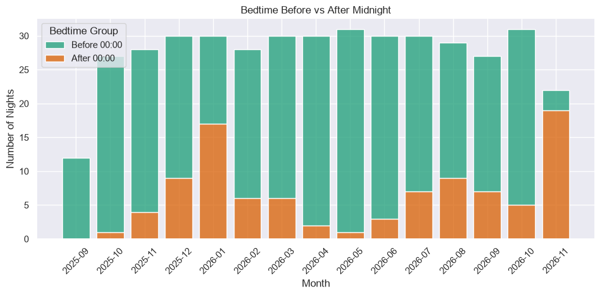
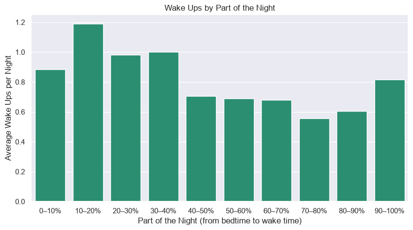
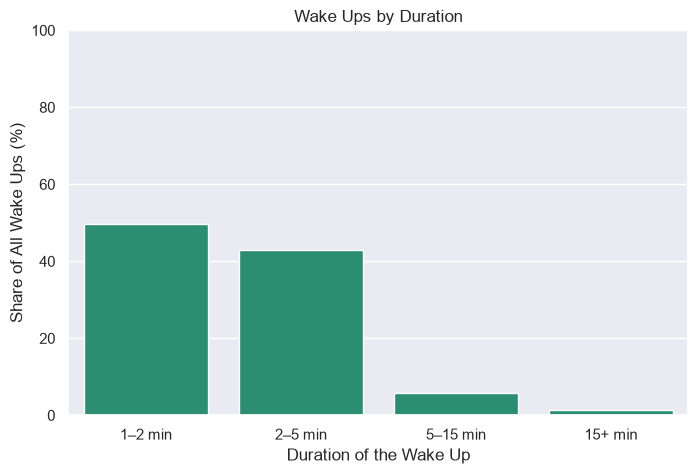

# Personal Sleep Analysis

## 1. Project Overview

This project aims to investigate sleeping patterns using my personal sleep data, recorded with an Apple Watch, over the span of 418 days. The analysis is ultimately to improve day-to-day sleep.

## 2. Problem Statement

This analysis is a personal project, to help me understand better my sleeping habits. If I can understand better when I tend to wake up more, I can ultimately take some actions in order to prevent them.

## 3. Objectives

- Discover during which seasons I tend to wake up more.
- Discover during which parts of the night I tend to wake up more.
- Measure how bedtime, and how consistent it is from night to night, relates to my sleep score and to the amount of deep and REM sleep.
- Identify which part of the sleep score (duration, bedtime or interruptions) most often pulls it down.

## 4. Research Questions

- Is there a relation between seasons and good sleep?
- Does going to bed early result in a better sleep?
- Are there patterns in wake ups during the night?

## 5. Hypotheses

- Worse overall sleeping scores during the summer.
- Going to bed later results to better sleep.

## 6. Data Quality Assessment

- Dropped columns: bedtime_y, awake_min_y and notes, as they were either duplicate columns or too many missing values.
- Renamed columns: bedtime_x to bedtime, awake_min_x to awake_min.
- Dropped rows where interruption_pts and wake_ups are missing (2 rows).
- Converted night, bedtime (former bedtime_x) and wake_time to datetime formats.
- Converted wake_ups to integer (it was stored as float because of missing values).
- For the bedtime and wake up analyses, left out 6 nights with a bedtime in the afternoon (13:12–15:34). These nights have 7–11 hours asleep, so the recorded bedtime is most likely the start of an afternoon nap that got merged into the night.
- For the sleep records (used for the wake up analysis), kept only the sleep stage rows (`SleepAnalysis`, 16,249 of 17,075), dropped the type, unit and source columns, renamed value to stage, and converted night, start and end to datetime formats.
- A wake up is an `Awake` record of at least 1 minute. Counting these per night gives exactly the `wake_ups` column on every night.

## 7. Analysis

### Is there a relation between seasons and good sleep?

In order to answer this question, I looked at three things:

1. Average sleep score by month
2. Average wake ups by month
3. Bedtime (before or after midnight) by month

#### Average Sleep Score by Month

The average sleep score by month showed that both the lowest average and highest average sleep score are both in summer - June 2026 and July 2026. However, winter is more often below the overall average sleep score, compared to summer.

Summer and autumn seem to have the overall highest average scores, and there seems to be slight positive general trend, but it's hard to bring any conclusions with just one year of data.

#### Average Wake Ups by Month

The average amount of wake ups per month seems to be telling a similar story as the average sleep score, but with more variability. July and August 2026 are the months with least amount of wake ups, but also November 2025 and January 2026 have similar average amounts.

With the amount of wake ups there doesn't seem to be any general trend.

#### Bedtime (Before or After Midnight) by Month

It seems that months where I go to bed after 00:00, I seem to be getting higher sleeping scores overall, with fewer wake ups.

### Does going to bed early result in a better sleep?

To answer this question, I compared bedtime (as a clock time) with the sleep score and its three components, time asleep, wake ups (in total and per hour asleep) and deep and REM sleep, over 409 nights. I split the nights into four bedtime groups: before 22:30 (95 nights), 22:30–23:30 (158), 23:30–00:30 (98) and after 00:30 (58).

#### Sleep Score by Bedtime

The best scores come with a bedtime between 22:30 and 23:30 (mean 85.9, median 88). Going to bed earlier than that doesn't help: before 22:30 the mean score is 82.6. After 00:30 the score drops sharply to a mean of 67.8, with a much wider spread. Some late nights still score in the 90s, but most of the very low scores are in this group.

#### Points Lost by Bedtime

After 00:30 the extra lost points come from duration (9.3 points lost vs 1.4–3.8 in the other groups) and bedtime consistency (13.0 vs 1.5–3.6). The consistency score rewards a regular bedtime, and bedtimes that late are unusual for me. Before 22:30, interruptions cost the most points (12.4), because these nights have the most wake ups per hour asleep (1.18 vs about 1.0 in the other groups). 22:30–23:30 loses the fewest points overall (14.1).

#### Time Asleep by Bedtime

Time asleep has the strongest relation with bedtime (Spearman r = −0.34). It goes from about 8.7 hours for a bedtime around 20:30 down to about 6.3 hours around 04:00, so on average getting up later after a late night doesn't make up for the lost sleep.

Later bedtimes come with fewer wake ups in total (r = −0.24), but mostly because a shorter night has less time to wake up in; per hour asleep the relation is weak (r = −0.13). The share of deep (11–12%) and REM (23–24%) sleep is about the same for every bedtime. Later bedtimes only mean fewer minutes of each because the night is shorter.

### Are there patterns in wake ups during the night?

To answer this question, I used the individual sleep records, where every wake up has its own start time and duration (3,317 wake ups over 409 nights). I looked at three things:

1. In which part of the night I wake up
2. How long the wake ups last
3. Wake ups by day of the week

#### Wake Ups by Part of the Night

Counting wake ups per clock hour would be misleading, because I'm asleep at some hours (like 03:00) on almost every night and at others (like 22:00) only on some. Instead, I placed every wake up on a scale from bedtime to wake time and split each night into equal parts, so that every night counts the same in each part.

I wake up most in the first third of the night: 3.4 times on average, against 2.5 in the middle third and 2.2 in the last third. The peak is at 10–20% of the night (1.19 wake ups per night), which for a typical night of about 8 hours in bed is roughly 50 to 100 minutes after going to bed. After the middle of the night the wake ups become less frequent, with the lowest point at 70–80% (0.56), and they go up again in the last tenth (0.82), just before waking up for the day.

#### Wake Ups by Duration

Almost all wake ups are short: half of them last 1–2 minutes and 93% are over within 5 minutes. Only 44 of 3,317 (1.3%) last 15 minutes or longer.

The early-night peak is made up of these short wake ups. The longer ones are spread differently: wake ups of 5–15 minutes are most common in the last third of the night (80, against 57 in the first and 59 in the middle third), and those of 15+ minutes in the middle third (24, against 13 and 7). So early in the night I wake up often but briefly, while later in the night I wake up less often but more of the wake ups are long.

#### Wake Ups by Day of the Week

Saturday nights have the fewest wake ups (7.5 on average, 0.94 per hour asleep) and Monday nights the most (8.6, 1.11 per hour). The difference between the best and worst day is only about 1 wake up, while within each day the number varies by 3 to 4 from night to night (standard deviation), with around 58 nights per day. This difference is too small to call a pattern.

## 8. Conclusions and Recommendations

### Does going to bed early result in a better sleep?

Going to bed early does not by itself give a better sleep, but going to bed late does give a worse one.

- My best nights start between 22:30 and 23:30. Going to bed earlier than that gives longer nights, but with more wake ups per hour.
- A bedtime after 00:30 lowers the score sharply (mean 67.8 vs 82.6–85.9 in the other groups), mostly because I sleep less and because those bedtimes are irregular for me.
- Bedtime doesn't change how much of the night is deep or REM sleep.

The hypothesis that going to bed later results in better sleep is not supported. The month-level comparison (months with more late bedtimes seeming to score higher) doesn't hold when looking at individual nights. These are correlations, not causes: late nights can have their own reasons (going out, stress, vacation) that also affect how I sleep.

**Recommendation:** aim for a bedtime between 22:30 and 23:30, and avoid going to bed after 00:30.

### Are there patterns in wake ups during the night?

There is a clear pattern in _when_ I wake up, but not in _which day_.

- I wake up most early in the night: 3.4 times on average in the first third, against 2.5 in the middle and 2.2 in the last third. The peak is roughly 50 to 100 minutes after going to bed.
- These early wake ups are mostly short. Almost all wake ups (93%) last less than 5 minutes; the longer ones (5+ minutes) are more common in the middle and last part of the night.
- There are slightly more wake ups just before the final wake up in the morning.
- The day of the week makes little difference.

**Recommendation:** since the first hours of the night have the most wake ups, the habits right before bed are the most likely place to look. The watch data can't show the cause, so a next step is to keep a simple log of evening habits (for example caffeine, alcohol, late meals or room temperature) and compare it with the number of wake ups in the first third of the night.

## 9. Limitations

- The data can't uncover causations for bad sleeping scores.
- Wake ups are what the watch detects; awake periods shorter than 1 minute are not counted, and the watch can't tell why I woke up.
