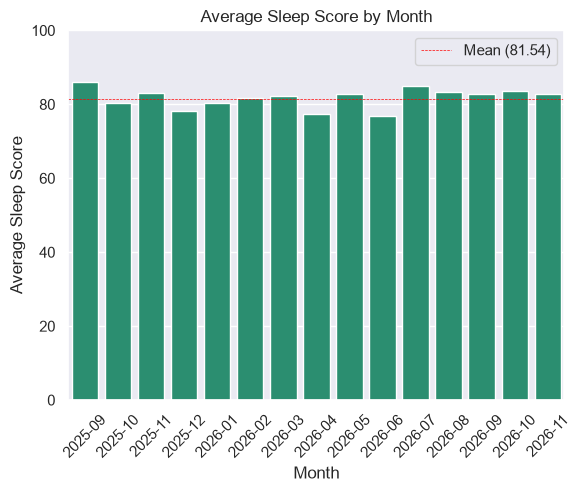

# Personal Sleep Analysis

## 1. Project Overview

This project aims to investigate sleeping patterns using my personal sleep data, recorded with an Apple Watch, over the span of 418 days. The analysis is ultimately to improve day-to-day sleep.

## 2. Problem Statement

This analysis is a personal project, to help me understand better my sleeping habits. If I can understand better when I tend to wake up more, I can ultimately take some actions in order to prevent them.

## 3. Objectives

- Discover during which seasons I tend to wake up more.
- Discover during which parts of the night I tend to wake up more.
- Measure how bedtime, and how consistent it is from night to night, relates to my sleep score and to the amount of deep and REM sleep.
- Identify which part of the sleep score (duration, bedtime or interruptions) most often pulls it down.

## 4. Research Questions

- Is there a relation between seasons and good sleep?
- Does going to bed early result in a better sleep?
- Are there patterns in wake ups during the night?

## 5. Hypotheses

- Worse overall sleeping scores during the summer.
- Going to bed later results to better sleep.

## 6. Data Quality Assessment

- Dropped columns: bedtime_y, awake_min_y and notes, as they were either duplicate columns or too many missing values.
- Renamed columns: bedtime_x to bedtime, awake_min_x to awake_min.
- Dropped rows where interruption_pts and wake_ups are missing (2 rows).
- Converted night, bedtime (former bedtime_x) and wake_time to datetime formats.
- Converted wake_ups to integer (it was stored as float because of missing values).

## 7. Analysis

### Is there a relation between seasons and good sleep?

In order to answer this question, I looked at three things:

1. Average sleep score by month
2. Average wake ups by month
3. Bedtime (before or after midnight) by month

#### Average Sleep Score by Month

The average sleep score by month showed that both the lowest average and highest average sleep score are both in summer - June 2026 and July 2026. However, winter is more often below the overall average sleep score, compared to summer.

Summer and autumn seem to have the overall highest average scores, and there seems to be slight positive general trend, but it's hard to bring any conclusions with just one year of data.

#### Average Wake Ups by Month

The average amount of wake ups per month seems to be telling a similar story as the average sleep score, but with more variability. July and August 2026 are the months with least amount of wake ups, but also November 2025 and January 2026 have similar average amounts.

With the amount of wake ups there doesn't seem to be any general trend.

#### Bedtime (Before or After Midnight) by Month

It seems that months where I go to bed after 00:00, I seem to be getting higher sleeping scores overall, with fewer wake ups.

## 8. Conclusions and Recommendations

<!-- A short answer to each research question, then concrete recommendations. -->

## 9. Limitations

- The data can't uncover causations for bad sleeping scores.
